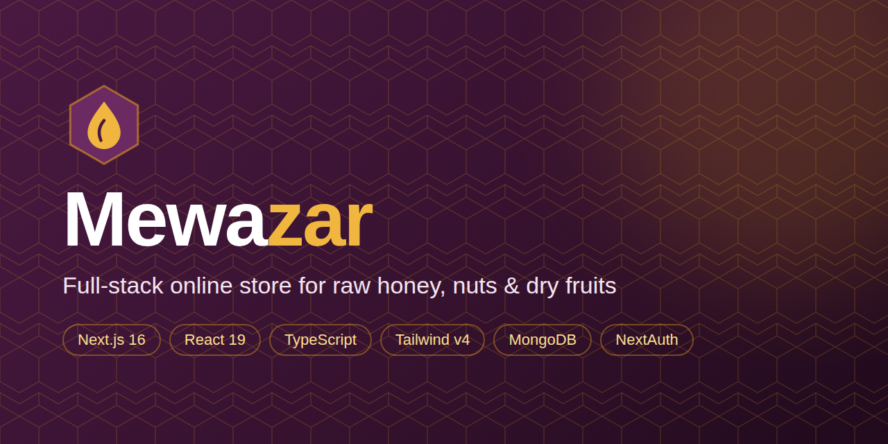
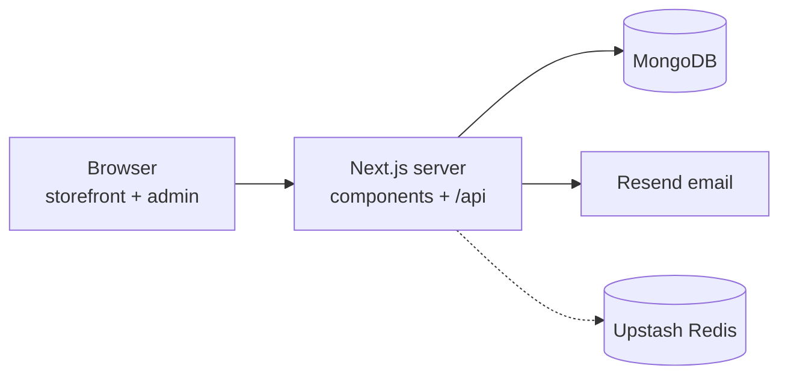

<div align="center">



# Mewazar

**A complete, full-stack online store for raw honey, nuts, dry fruits, dates, spices, tea, ghee and gift boxes, with an admin panel the shop owner runs without writing code.**


</div>

## Overview
Mewazar is built for a Pakistani food business: customers browse by category, pick pack sizes (250g / 500g / 1kg),
pay by Cash on Delivery, bank transfer or wallet, and track their parcel. The owner manages products, stock, orders,
coupons, reviews, couriers, categories, page text and even the shop name and logo from a built-in admin panel.

The storefront is fast (server components with a one-minute cache), SEO-ready, responsive from phones to desktops
and has a light and a dark theme.

## Features

### Storefront
- 11 starter categories and 50 starter products; owners can add their own categories
- Product pages with gallery, pack sizes, sale prices, stock warnings and customer reviews
- Cart drawer with free-delivery progress, wishlist, live search suggestions, filters and sorting
- Checkout with Cash on Delivery, bank transfer and wallets, coupons and reward coins
- Public order tracking (order number + phone) and "My orders" with courier tracking links
- First-visit loading screen, marquee, scroll progress bar, page transitions and honeycomb animations
- Light and dark mode, reduced-motion support, accessible navigation
- SEO: sitemap, robots, Open Graph, schema.org product data; 404 and error pages

### Admin panel (`/admin`)
| Area | What the owner can do |
| --- | --- |
| Dashboard | Orders today, payments to verify, revenue, low stock, reviews and messages waiting |
| Products | Add, edit, hide, delete; pack sizes, prices, sale price, stock; upload photos or paste links |
| Orders | Move through stages, verify or refund payments, courier and tracking ID, notes, invoice, WhatsApp message |
| Categories | Add, rename, recolour, reorder |
| Customers | View accounts and reward coins; add or remove coins |
| Reviews | Approve, unpublish, delete |
| Messages | Contact form inbox |
| Content | Shop name, logo, home page text, FAQ, About page and policies |
| Settings | Contact, delivery, pause orders, announcement, payments, coupons, couriers and tracking links, reward rules |

### Customer accounts
Google, GitHub or email sign-in, email confirmation, password reset, order history and reward coins.

## Tech stack
| Layer | Technology |
| --- | --- |
| Framework | Next.js 16 (App Router, server components, route handlers), React 19 |
| Language | TypeScript |
| Styling | Tailwind CSS v4 with design tokens, light and dark themes |
| Database | MongoDB Atlas with Mongoose |
| Auth | NextAuth (Google, GitHub, credentials), bcrypt |
| Email | Resend HTTP API (no extra package) |
| Rate limiting | In-memory, or Upstash Redis when configured |
| Hosting | Vercel (any Node 20+ host works) |

## Architecture

More detail: [docs/ARCHITECTURE.md](docs/ARCHITECTURE.md).

## Getting started
Requires **Node.js 20.9+**.

```bash
git clone https://github.com/lamiakajal/mewazar.git
cd mewazar
npm install
cp .env.example .env.local     # then fill in the values
npm run dev                    # http://localhost:3000
```

The full walkthrough (MongoDB Atlas, Google sign-in, Resend, first-time admin setup) is in
[SETUP-GUIDE.md](SETUP-GUIDE.md). The shop owner's manual is in [docs/ADMIN-GUIDE.md](docs/ADMIN-GUIDE.md).

## Environment variables
| Variable | Required | Purpose |
| --- | --- | --- |
| `MONGODB_URI` | yes | MongoDB connection string |
| `NEXTAUTH_SECRET`, `NEXTAUTH_URL` | yes | NextAuth secret and site URL |
| `NEXT_PUBLIC_SITE_URL` | yes | Public URL for SEO and email links |
| `GOOGLE_CLIENT_ID`, `GOOGLE_CLIENT_SECRET` | yes | Google sign-in (admin login) |
| `ADMIN_EMAILS` | yes | Comma-separated admin emails (Google or GitHub sign-in) |
| `GITHUB_CLIENT_ID`, `GITHUB_CLIENT_SECRET` | no | GitHub sign-in |
| `RESEND_API_KEY`, `EMAIL_FROM`, `ADMIN_NOTIFY_EMAIL` | no | Order, reset and confirmation emails |
| `UPSTASH_REDIS_REST_URL`, `UPSTASH_REDIS_REST_TOKEN` | no | Shared rate limiting |

## Scripts
| Command | Description |
| --- | --- |
| `npm run dev` | Start the development server |
| `npm run build` | Create the production build |
| `npm start` | Run the production build |
| `npm run lint` | Run ESLint |
