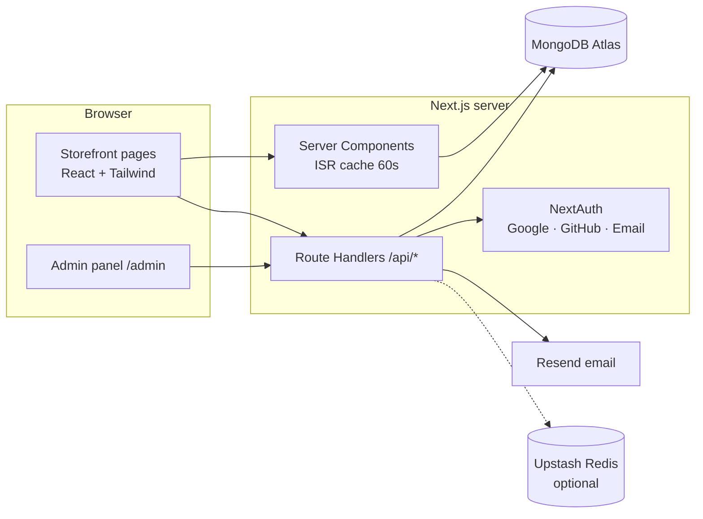

# Architecture



## Data flow in one paragraph
Catalog, settings and page text are stored in MongoDB and read by server components, which are cached for a minute
(and refreshed immediately when the admin saves). Before the database is seeded, built-in starter data is used, so
the store always renders. The browser never decides prices: the checkout sends product IDs, pack sizes, quantities,
a coupon code and a coin amount, and `POST /api/orders` rebuilds everything from the database.

## Main collections
| Collection | Purpose |
| --- | --- |
| `products` | Name, category, images, pack sizes with price / sale price / stock |
| `orders` | Items, address, payment, status, courier, coins used and earned |
| `users` | Customers and admins, hashed password, coin balance |
| `settings` | One document: contact, delivery, payments, coupons, couriers, rewards, categories, brand, home text, FAQ, page text |
| `reviews`, `contactmessages`, `cointransactions`, `imageassets` | Reviews, inbox, coin history, uploaded photos |

## Key rules
- **Stock** is reserved with an atomic conditional update, and returned on cancellation.
- **Reward coins** are earned on delivery and spent atomically at checkout, with a ledger for every change.
- **Admins** are promoted only through Google or GitHub sign-in for emails listed in `ADMIN_EMAILS`.
- **Settings sections** are saved with `$set` per section, so one admin page never overwrites another.

## Folder map
```
src/
  app/            routes: storefront, /admin, /api
  components/     ui primitives, home sections, product, cart, checkout, admin
  context/        cart, wishlist, settings (client)
  data/           brand defaults, starter categories and products
  lib/            pricing, settings, catalog, rewards, email, rate limit, rich text
  models/         Mongoose models
  types/          shared TypeScript types
```
